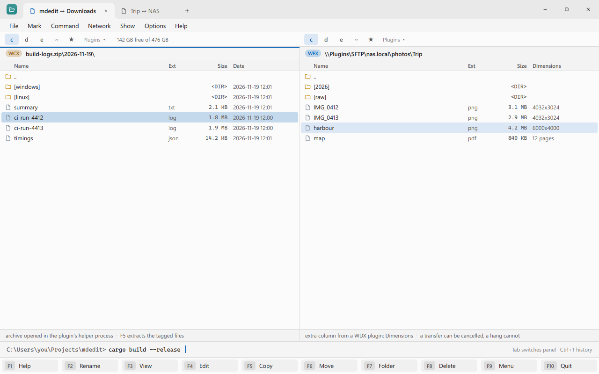
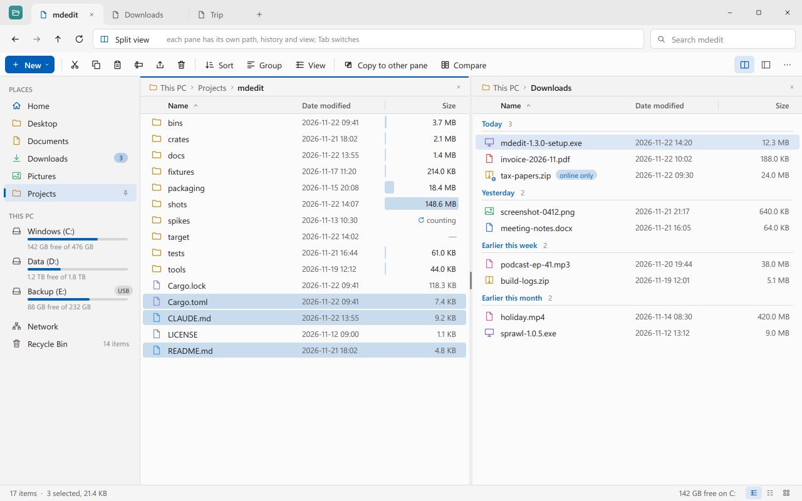
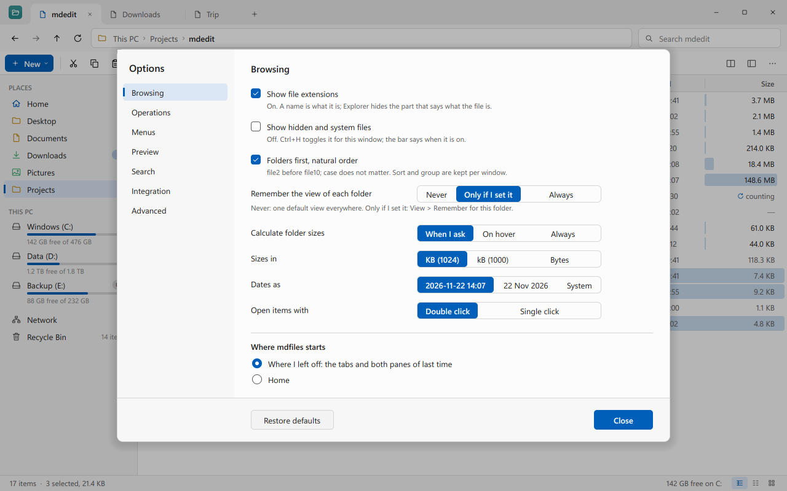
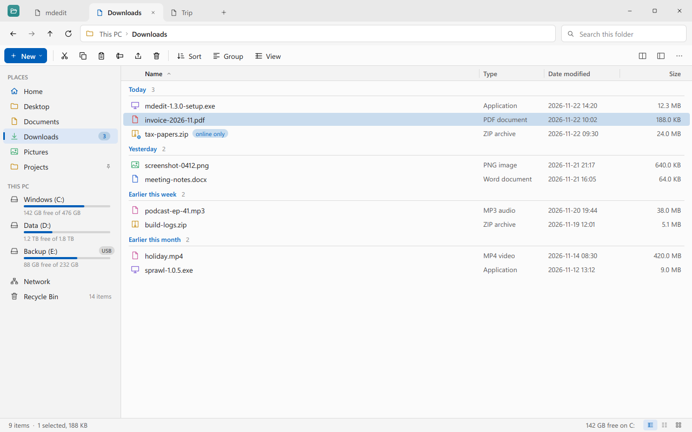
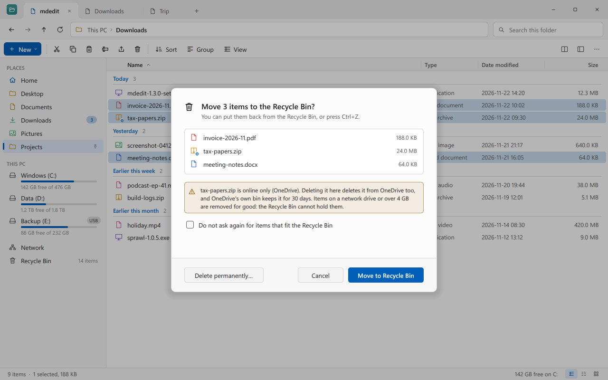
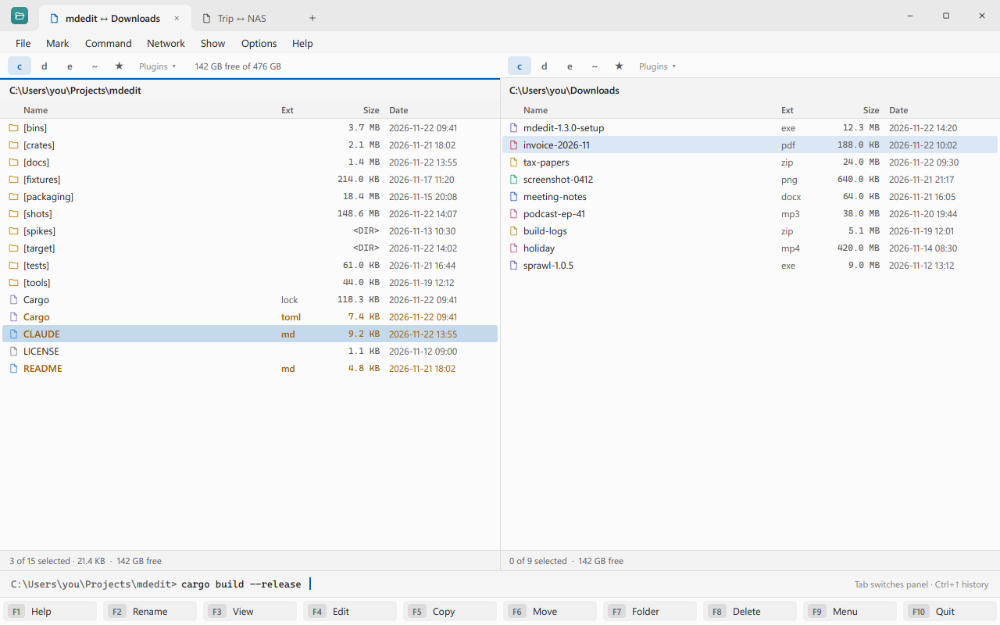
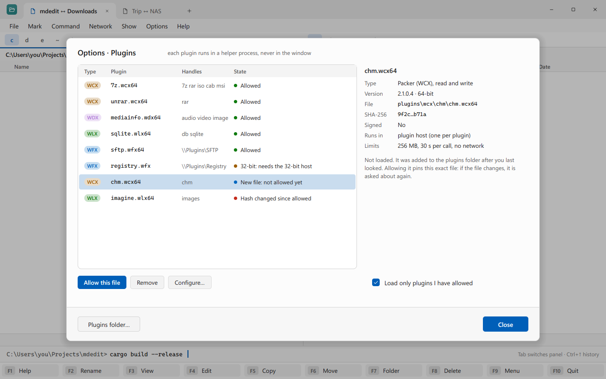
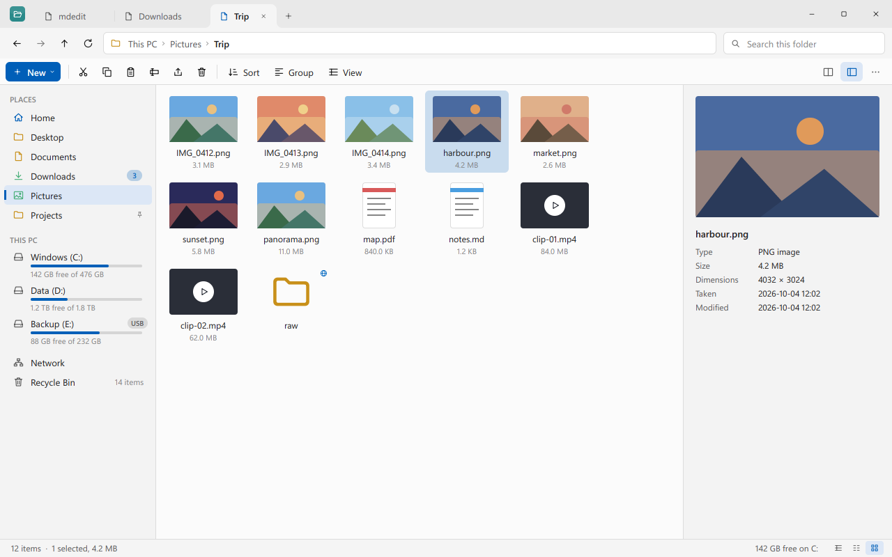

# File manager: the open questions, explained

The remaining questions of `docs/file-manager-plan.md` section 17, each with what it means, a picture where there is one, and my recommendation. Question 3 (the context menu) is answered: **B**. Pictures are in `shots/mock-fm/` (light and dark of each exist).

| # | Question | My recommendation |
|---|---|---|
| 1 | Name | Pick a short one |
| 2 | Where it lives | New repository |
| 4 | `windows` crate for COM | Yes |
| 5 | `zip` crate | Yes, after pricing |
| 6 | Split view per tab or per window | Per tab |
| 7 | Remember each folder's view | Only on request |
| 8 | Elevated job runner | Yes |
| 9 | Terminal here | Windows Terminal until ours exists |
| 10 | Cloud files | First-class |
| 11 | Commander layout and plugins | Layout on the roadmap, no plugins |
| 12 | Hub | Yes, one more row |

---

## 1. Name

"mdfiles" is a working name. The family is mdview, mdedit, Sprawl, Hub. A short name that fits them is worth choosing before the repository exists, because the name goes into the exe, the installer and the settings folder.

## 2. Where it lives

mdview and mdedit each have their own repository, pinned to `markdown-shared-rs` by commit. **Recommend a new repository** (`markdown-files-rs`): its own CI, releases and `docs/STATE.md`, and Hub can list it like the others. The alternative, a second binary in this repository, keeps one CI but ties its releases to the editor's.

## 4. May the app use the `windows` crate directly?

Drag and drop, the "More options" menu, thumbnails and Open with are all COM. With `windows-sys` (what the family uses) we would write the COM tables by hand: about 600 lines of unsafe code.

The `windows` crate (0.62.2) is **already in `Cargo.lock`**, pulled in by `trash`, so this adds no new entry. It only adds the features we switch on and a heavier compile. Exe size and launch time are not measured yet; nothing runs before first use. **Recommend yes.**

## 5. May I add the `zip` crate?

Without it there are no archives in the first version. It would be a new `Cargo.lock` entry; I price it with `cargo tree` before adding it, as rule 7 says. 7z and rar are not covered either way (that is the plugin question, 11). **Recommend yes.**

## 6. Split view: per tab or per window?

**Per tab** (recommended): each tab remembers whether it is split, so one tab can be a single folder and another two. **Per window**: one split state for all tabs, simpler but less flexible. Either way it is off by default (F3).

## 7. Remember each folder's view?

Explorer remembers per folder and then guesses a folder's type from its contents, switching the view under you. **Recommend "only if I set it"**: one default everywhere, and View > Remember for this folder for the few you care about (Trip as icons, Downloads grouped). It is the middle segment of the setting in the picture.

## 8. A second, elevated process for "Access denied"?

When an operation hits a protected file, the queue offers Skip, Retry, or **Retry as administrator**. The window itself never runs elevated (an elevated window also refuses drops from normal programs). "Retry as administrator" would start a **second copy of the job runner** with a Windows prompt, do the one job, and exit. The alternative is never elevating and saying "run as administrator yourself". **Recommend the job runner.**

## 9. Terminal here

Opens the family terminal if it is built (`docs/terminal.md`), otherwise Windows Terminal, otherwise `cmd`. **Recommend that order**; it costs half a day and does not depend on the terminal decision.

## 10. Cloud files (OneDrive and the like)

An "online only" file is not on the PC. Opening, copying, previewing or hashing it **downloads it**; deleting it **deletes it from the cloud**. **First-class** (recommended, about 3 days of the plan): a chip in the row, a badge on the icon, a question before any download, a sentence in the delete dialog, and previews and thumbnails that skip such files. **Best effort**: they look like plain files, and a naive copy of a folder can pull gigabytes.

## 11. Commander layout and plugins

The commander layout (two panels, function keys, command line) is **10-12 days** on the same engine, because split view needs two panes anyway. **Recommend putting it on the roadmap**, after the standard window.

Plugins are a separate decision (`docs/commander-plugins.md`). Total Commander packers (WCX) and content columns (WDX) are cheap; file systems (WFX) and viewers (WLX) are large and risky; third-party DLLs in our process can crash us. **Recommend no plugins now.** If asked later: built-in zip first, then WCX read-only plus WDX behind a separate plugin host process, about 23 days.

## 12. Hub

Whether the file manager is one more row in the launcher (`docs/launcher-plan.md`), installed and updated like mdview and mdedit, sharing the install folder. **Recommend yes**; it needs a release manifest, which the family's updater already defines.
