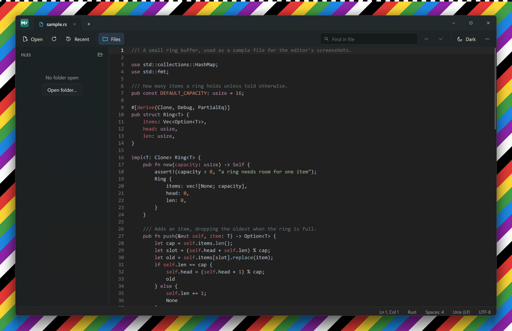
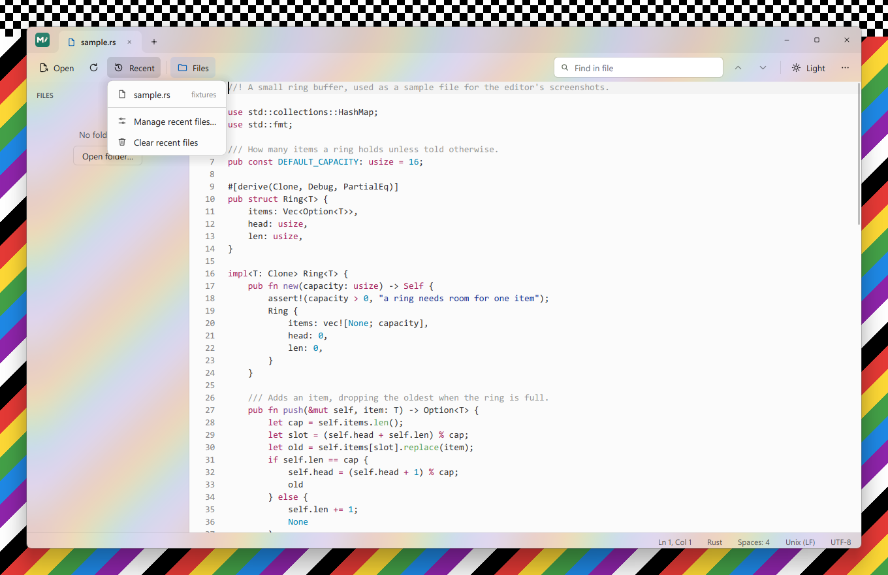

# Kitchen renovation

A long note with pictures, tables, code, quotes, nested lists, math and a diagram: the things
whose rendered height differs most from their source.



## Budget

| Item | Supplier | Quantity | Unit price | Total | Notes |
|------|----------|---------:|-----------:|------:|-------|
| Cabinets | Local workshop | 12 | 310 | 3,720 | Oak fronts, soft close |
| Worktop | Stone yard | 1 | 1,450 | 1,450 | Quartz, 3 cm |
| Sink | Online | 1 | 240 | 240 | Undermount |
| Tap | Online | 1 | 180 | 180 | Pull-out spray |
| Tiles | Tile shop | 14 m² | 38 | 532 | Matte white |
| Lights | Electrician | 6 | 45 | 270 | Under-cabinet LED |
| Labour | Builder | 9 days | 260 | 2,340 | Two people |

Total so far: **8,732**, before the electrician's own invoice.

## Plan

1. Measure everything twice
   - walls, including the crooked one
   - window height from the floor
     - and the sill's depth
2. Order the cabinets (six weeks)
3. Strip the old kitchen
   > Keep the old sink for the garden.
4. Fit, tile, light

- [x] Get three quotes
- [ ] Book the builder
- [ ] Pick the tiles



> **Note**
> The builder starts only after the cabinets arrive. A delay at the workshop moves everything,
> so the order goes in first, even before the old kitchen comes out.
>
> > Nested: the workshop said "six weeks, maybe seven".

## Wiring

```rust
/// Load per circuit, in watts.
fn load(appliances: &[(&str, u32)]) -> u32 {
    appliances.iter().map(|(_, w)| w).sum()
}

fn main() {
    let kitchen = [("oven", 3500), ("hob", 7200), ("kettle", 3000), ("dishwasher", 2000)];
    println!("{} W", load(&kitchen));
}
```

The hob alone needs its own circuit: $P = U \cdot I$, so at 230 V a 7.2 kW hob draws

$$
I = \frac{7200}{230} \approx 31.3\ \text{A}
$$


## Small things

A short paragraph between big ones.


<details>
<summary>Old measurements</summary>

Wall A 3.42 m, wall B 2.80 m, ceiling 2.55 m.

</details>

Term
: A definition list item, if the renderer has them.

---

A last paragraph with a footnote[^1] and a [reference link][ref].

[^1]: Measured on 2026-11-01.

[ref]: https://example.com
